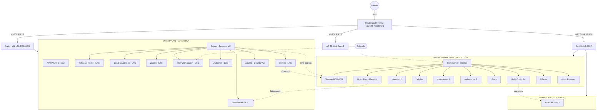

# Homelab & On-Premise Infrastructure — Cloud Infra, Networking & DevOps


Architecture repository, operational documentation, and sanitized configurations for my **Homelab**: a hybrid virtualization (**Proxmox VE**) and containerization (**Docker**) environment designed under enterprise standards for continuous hands-on practice in **Network Engineering, Security, Observability, Distributed Storage, and DevOps Automation**.

> [!IMPORTANT]
> **Security Notice (OPSEC):** All IP addresses, subnets, and VLAN IDs in this repository are **fictitious** (RFC 1918) and serve exclusively to illustrate the topology and architectural design. No credentials, private keys, or sensitive data are versioned in this repository.

---

## Engineering Highlights

- **Network Segmentation & Inter-VLAN Firewall:** L2/L3 topology built around a core **MikroTik hEX (`RB750Gr3`)** router and managed switches (**FortiSwitch 108F** + **MikroTik `RB260GS`**), isolating traffic across 3 trust zones (`Infra/Core`, `Servers DMZ`, and `Guest Network`).
- **High-Availability DNS (Automated Failover):** Centralized ad/telemetry blocking via **AdGuard Home** paired with a native RouterOS healthcheck/failover script ([`dns-failover.rsc`](configs/mikrotik/dns-failover.rsc)) that automatically switches network DNS to Google Public DNS (`8.8.8.8`) during hypervisor maintenance windows, eliminating Single Points of Failure (SPOF).
- **Private PKI (`step-ca`) & Zero Port-Forwarding:** Zero inbound ports exposed on the WAN interface. External administrative access uses a WireGuard Mesh VPN (**Tailscale**), while internal web services enforce HTTPS using certificates issued by an internal Certificate Authority (**Smallstep `step-ca`**) terminated at **Nginx Proxy Manager** ([`reverse-proxy.conf`](configs/nginx/reverse-proxy.conf)).
- **Hybrid Cross-VLAN Storage & BDR:** Transactional databases and LXC containers run on local **SSD** storage on the Proxmox host (`Saturn`), while bulk data leverages a **4 TB HDD** on the `Homeserver` exported across VLANs via **NFS** (*Immich* photo library) and **SMB/CIFS** (automated nightly `vzdump` backups with a 7-day rolling retention policy).
- **Hybrid Observability (SNMP + Agents):** Centralized monitoring with **Zabbix** collecting SNMP WAN link telemetry from the MikroTik router, DNS health metrics, and CPU/thermal sensors from physical servers.

---

## Architecture Diagram & Physical/Logical Topology



---

## Network Zones & Hardware Summary

| VLAN ID (Fictitious) | Subnet | Trust Zone / Purpose | Devices & Workloads |
| :--- | :--- | :--- | :--- |
| **VLAN 10** | `10.0.10.0/24` | **Infrastructure & Core** | Proxmox Hypervisor (`Saturn`), core LXCs (DNS, PKI, IdP, Monitoring), Ansible VM, and Main Wi-Fi (TP-Link Deco #1 and #2). |
| **VLAN 20** | `10.0.20.0/24` | **Servers (Internal DMZ)** | `Homeserver` (Ubuntu Server 24.04 + Docker), bulk storage (4 TB HDD), and firewall-isolated application services. |
| **VLAN 30** | `10.0.30.0/24` | **Guest Network (Isolated)** | Dedicated UniFi AP (Gen 1) on FortiSwitch Port 7, restricted exclusively to Internet (WAN) access. |

| Host / Asset | Infrastructure Role | Key Specifications | Operating System |
| :--- | :--- | :--- | :--- |
| **Saturn** | Core Hypervisor (VLAN 10) | Intel Core i3-7100T \| 16 GB RAM \| 256 GB SSD | Proxmox VE (Debian-based) |
| **Homeserver** | Container & Storage Host (VLAN 20) | Intel Core i7-9700 \| 16 GB RAM \| 250 GB SSD + 4 TB HDD | Ubuntu Server 24.04 LTS |
| **Core Router** | Gateway, NAT, DNS Failover & Firewall | MikroTik hEX `RB750Gr3` | RouterOS |
| **L2 Switches** | 802.1Q Trunking & Distribution | `FortiSwitch 108F` + MikroTik `RB260GS` | FortiSwitchOS / SwOS |
| **Access Points** | Main & Guest Wireless | 2x `TP-Link Deco` (VLAN 10) + `UniFi AP Gen1` (VLAN 30) | Native Firmware |

---

## Repository Structure & Navigation

```text
.
├── README.md                                  # Executive overview, engineering highlights, and topology diagram
├── .gitignore                                 # Protection against committing secrets, certificates, and IaC state
├── docs/
│   ├── inventory.md                           # Detailed hardware, LXC/VM, Docker, port, and firewall inventory
│   ├── network-and-security.md                # Physical port-to-port map, DNS Failover, step-ca PKI, and Tailscale
│   ├── observability.md                       # Zabbix monitoring (SNMP + Agent), WAN, CPU, and thermal metrics
│   ├── runbooks.md                            # SOPs for backup/restore (SMB), hybrid storage (NFS), and maintenance
│   ├── architectural-decisions.md             # Formal ADRs explaining the technical rationale behind design choices
│   └── engineering-case-studies.md            # Real-world troubleshooting cases (Root Cause -> Engineering Solution)
└── configs/
    ├── mikrotik/
    │   └── dns-failover.rsc                   # RouterOS Netwatch script for automated DNS high availability
    ├── nginx/
    │   └── reverse-proxy.conf                 # TLS Reverse Proxy config (Local + Cross-VLAN Vaultwarden)
    ├── storage/
    │   └── nfs-and-smb-shares.conf            # NFS exports (Immich) and Samba SMB share (Proxmox vzdump backups)
    ├── ansible/
    │   ├── hosts.ini                          # Ansible inventory segmented by VLAN and role
    │   └── site-maintenance.yml               # APT patching, service healthcheck, and Docker prune playbook
    ├── proxmox-lxc/                           # Docker Compose stacks running inside Proxmox Debian LXCs (VLAN 10)
    │   ├── immich/
    │   │   └── docker-compose.yml             # Immich Server + ML + Valkey + Postgres (SSD) + NFS Mount (/mnt/fotos)
    │   ├── authentik/
    │   │   └── docker-compose.yml             # Authentik IdP Server + Worker + PostgreSQL 16
    │   └── vaultwarden/
    │       └── docker-compose.yml             # Hardened Vaultwarden (no-new-privileges + private IP bind)
    └── docker/                                # Modular Docker Compose stacks for Homeserver (VLAN 20)
        ├── env.example                        # Sanitized environment variables template (.env)
        ├── nginxproxymanager/
        │   └── docker-compose.yml
        ├── homarr/
        │   └── docker-compose.yml
        ├── gitea/
        │   └── docker-compose.yml
        ├── code-server/
        │   └── docker-compose.yml
        ├── codeserver-2/
        │   └── docker-compose.yml
        ├── unifi-controller/
        │   └── docker-compose.yml
        ├── jellyfin/
        │   └── docker-compose.yml
        ├── ollama/
        │   └── docker-compose.yml
        ├── n8n/
        │   └── docker-compose.yml
        └── myspeed/
            └── docker-compose.yml
```

### Technical Documentation Index (`en/docs/`)
1. **[Technical Inventory & Architecture (`docs/inventory.md`)](docs/inventory.md):** Complete resource allocation tables (vCPU/RAM/Swap), port mappings, and inter-VLAN firewall matrix.
2. **[Networking, Physical Port Map, PKI & Security (`docs/network-and-security.md`)](docs/network-and-security.md):** Port-to-port wiring (`RB750Gr3`, `FortiSwitch 108F`, `RB260GS`), DNS failover sequence diagram, `step-ca` PKI, and Tailscale VPN.
3. **[Observability & Monitoring (`docs/observability.md`)](docs/observability.md):** Hybrid Zabbix telemetry collection (SNMP + Agent) covering WAN link throughput, CPU load, DNS health, and `Homeserver` thermal sensors.
4. **[Operational Runbooks & Storage (`docs/runbooks.md`)](docs/runbooks.md):** Cross-VLAN hybrid storage architecture (NFS + SMB) and Standard Operating Procedures (SOPs) for *Backup & Disaster Recovery*.
5. **[Architecture Decision Records — ADRs (`docs/architectural-decisions.md`)](docs/architectural-decisions.md):** Formal engineering decisions and trade-offs (LXC vs. Docker, Cross-VLAN Storage, DNS Failover, and Zero Port-Forwarding).
6. **[Engineering Case Studies & Troubleshooting (`docs/engineering-case-studies.md`)](docs/engineering-case-studies.md):** Real-world operational challenges documented in *Symptom -> Root Cause -> Engineering Solution* format.

---

## Roadmap / Work in Progress

- [ ] **Automated Alerting:** Zabbix Webhook integration with **Discord** for proactive alerting (CPU thermal thresholds, disk usage, and service downtime).
- [ ] **Identity Expansion (SSO):** Integrating **Authentik** across upcoming self-hosted applications (including **Paperless-ngx**).
- [ ] **Infrastructure as Code (IaC):** Automated provisioning of Proxmox LXC containers and KVM VMs using Terraform/OpenTofu.
- [ ] **Configuration Management:** OS baseline standardization, automated patching, and Docker Compose deployments via Ansible playbooks.
- [ ] **Self-Hosted CI/CD:** Automated validation and deployment pipelines powered by **Gitea Actions**.
