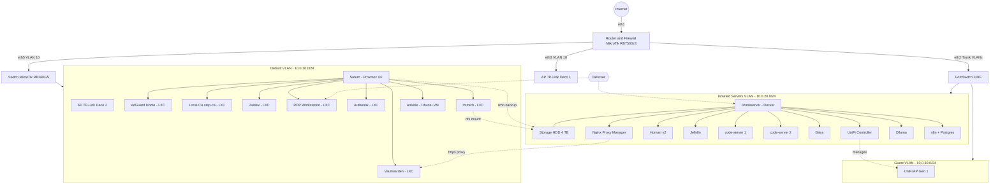

# Technical Inventory & Homelab Architecture

> [!NOTE]
> All IP addresses and VLAN IDs documented below are **fictitious** (RFC 1918), adopted to protect real-world operational security while remaining faithful to the physical and logical architecture of the environment.

---

## 1. Network Topology & Segmentation

The network implements IEEE 802.1Q VLAN segmentation. A **MikroTik hEX (RB750Gr3)** acts as the default gateway across all subnets and centralizes the stateful inter-VLAN firewall. Layer 2 switching and 802.1Q trunk distribution are handled by a **FortiSwitch 108F** and a **MikroTik RB260GS**.

| VLAN ID | Subnet (Example) | Gateway | Trust Zone | Description & Scope |
| :--- | :--- | :--- | :--- | :--- |
| **VLAN 10** | `10.0.10.0/24` | `10.0.10.1` | **Default (Infra & Core)** | Primary network. Hosts the Proxmox hypervisor (`Saturn`), core services (DNS, CA, IdP, Monitoring, Automation), and primary Wi-Fi (TP-Link Deco). |
| **VLAN 20** | `10.0.20.0/24` | `10.0.20.1` | **Servers (Isolated DMZ)** | Dedicated segment for `Homeserver` (Docker + Bulk Storage). Isolated from the main LAN by restrictive firewall rules. |
| **VLAN 30** | `10.0.30.0/24` | `10.0.30.1` | **Guest (Isolated)** | Strictly isolated segment for the 1st-Gen UniFi AP. Allows outbound Internet (WAN) access only, blocking all RFC 1918 destinations. |

### Networking Hardware

| Asset | Model | Layer / Role | Operational Notes |
| :--- | :--- | :--- | :--- |
| **Router / Firewall** | MikroTik hEX `RB750Gr3` | L3 / Routing, Firewall, NAT & DHCP | Centralizes filtering policies across VLANs 10, 20, and 30, plus automated DNS failover. |
| **Distribution Switch** | Fortinet `FortiSwitch 108F` | L2 Managed (802.1Q) | Trunk uplink to `RB750Gr3` (`eth2`); delivers isolated access ports to `Homeserver` (VLAN 20) and `UniFi AP` (VLAN 30). |
| **Access Switch** | MikroTik `RB260GS` (CSS106-5G-1S) | L2 Managed (SwOS) | Connected to `RB750Gr3` (`eth5`); provides gigabit ports for `Saturn` (Proxmox) and secondary `TP-Link Deco`. |
| **Primary Wi-Fi** | TP-Link `Deco` (2 Nodes) | Access Points (VLAN 10) | Wireless coverage for trusted devices on the primary network. |
| **Guest Wi-Fi** | Ubiquiti `UniFi AP (Gen 1)` | Access Point (VLAN 30) | Isolated wireless network for guests, managed by the UniFi Controller in VLAN 20. |

---

## 2. Architecture Diagram

---

## 3. Compute Hardware Inventory

| Host | Role | CPU | RAM | Local Storage | Operating System |
| :--- | :--- | :--- | :--- | :--- | :--- |
| **Saturn** | Infrastructure Hypervisor | Intel Core i3-7100T (2C/4T) | 16 GB DDR4 | 256 GB SSD (OS + LXC/VM Volumes) | Proxmox VE |
| **Homeserver** | Container & Storage Host | Intel Core i7-9700 (8C/8T) | 16 GB DDR4 | 250 GB SSD (OS/Docker) + 4 TB HDD (Data) | Ubuntu Server 24.04 LTS |

---

## 4. Workloads & Services

### 4.1. VLAN 10 — Hypervisor `Saturn` (Proxmox VE)

| Service | Type | Base OS | vCPU | RAM (Limit) | Swap | IP (Example) | Infrastructure Role |
| :--- | :--- | :--- | :---: | :---: | :---: | :--- | :--- |
| **AdGuard Home** | LXC | Debian | 1 | 2 GB | 1 GB | `10.0.10.11` | Primary DNS ad-blocker with automated RouterOS failover to Google DNS. |
| **Local CA (`step-ca`)** | LXC | Debian | 1 | 512 MiB | 0 | `10.0.10.12` | Private Certificate Authority (`Smallstep step-ca`) issuing internal TLS certs (`ga.lab.arpa`). |
| **Zabbix** | LXC | Debian | 2 | 8 GB | 6 GB | `10.0.10.13` | Infrastructure observability (SNMP router link monitoring + Linux Zabbix Agents). |
| **RDP Workstation** | LXC | Debian | 2 | 6 GB | 5 GB | `10.0.10.14` | Jump host / remote workstation accessible externally via Tailscale VPN. |
| **Vaultwarden** | LXC | Debian | 1 | 512 MiB | 512 MiB | `10.0.10.15` | Bitwarden-compatible password manager (exposed via HTTPS through Nginx in VLAN 20). |
| **Authentik** | LXC | Debian | 2 | 3 GB | 2 GB | `10.0.10.16` | Identity Provider (IdP) for centralized authentication and Single Sign-On (SSO). |
| **Immich** | LXC | Debian | 2 | 8 GB | 4 GB | `10.0.10.17` | Self-hosted photo/video management (DB on Proxmox SSD; media library mounted via NFS on `Homeserver` 4 TB HDD). |
| **Ansible** | VM (KVM) | Ubuntu | 2 | 2 GB | N/A | `10.0.10.18` | Control Node for configuration management and automated maintenance playbooks. |

> [!TIP]
> **Elastic Memory Allocation (LXC Overcommitment):** The sum of configured RAM limits across LXC containers and the VM totals ~30 GB on a physical host with 16 GB RAM. Because LXC containers share the Proxmox host kernel and consume only actively allocated memory pages, overprovisioning allows individual workloads (such as Immich ML indexing or heavy Zabbix queries) to burst without wasting idle resources.

---

### 4.2. VLAN 20 — `Homeserver` (Docker Engine)

All services below run as Docker containers on `10.0.20.10` (`Ubuntu Server 24.04 LTS`):

| Container / Service | Role | Published Port(s) | Exposed via NPM? | Technical Notes |
| :--- | :--- | :--- | :---: | :--- |
| **Nginx Proxy Manager** | Reverse Proxy & TLS Termination | `80/tcp`, `443/tcp`, `81/tcp` (Admin) | — | HTTP/HTTPS entrypoint using internal CA certificates (`step-ca`). |
| **Homarr v2** | Central Infrastructure Dashboard | `7576/tcp` (Internal `7575`) | Yes | Integrated with `/var/run/docker.sock` (read-only) for container status monitoring. |
| **Gitea** | Self-Hosted Git & CI/CD | `3000/tcp`, `2222/tcp` (SSH) | No | Local Git repository hosting and Gitea Actions pipelines. |
| **code-server 1** | Browser-Based IDE (VS Code) | `8444/tcp` (Internal `8443`) | No | Primary isolated development workspace. |
| **codeserver-2** | Browser-Based IDE (VS Code) | `8455/tcp` (Internal `8443`) | No | Secondary isolated development workspace. |
| **UniFi Controller** | Wireless Network Management | `8443/tcp`, `8080/tcp` (Inform), `3478/udp` (STUN), `10001/udp` | No | Manages the 1st-Gen UniFi AP deployed in VLAN 30 (Guest). |
| **Jellyfin** | Media Server (Hardware Transcoding) | `8097/tcp` (HTTP), `8921/tcp` (HTTPS), `7359/tcp` | Yes | Passes through Intel UHD 630 iGPU (`/dev/dri`) for Intel QuickSync transcoding. |
| **Ollama** | Local AI / LLM Inference | `11434/tcp` | No | Local Large Language Model execution with `/dev/dri` device access. |
| **n8n + PostgreSQL** | Workflow Automation (Lab) | `5678/tcp` (Internal Postgres `5432`) | No | Multi-container stack with dedicated PostgreSQL 14 database and native healthchecks. |
| **MySpeed** | WAN Link Telemetry | `5216/tcp` | No | Automated historical tracking of WAN bandwidth and latency. |

---

## 5. Traffic Flows, Reverse Proxy & Distributed Storage

### 5.1. Reverse Proxy (Nginx Proxy Manager) & Internal PKI
- **Nginx Proxy Manager** (`10.0.20.10`) acts as the reverse proxy for web applications requiring friendly HTTP/HTTPS access and TLS termination: **Homarr v2**, **Jellyfin** (both local on `Homeserver`), and **Vaultwarden** (hosted on `Saturn` in VLAN 10 at `10.0.10.15`).
- The **Local CA (`step-ca` — `ga.lab.arpa`)** signs internal TLS certificates to provide trusted HTTPS connections across the LAN/VPN (required for the browser WebCrypto API used by Vaultwarden/Bitwarden clients).

### 5.2. Cross-VLAN Shared Storage
- `Homeserver` houses the high-capacity **4 TB HDD**.
- In addition to serving local Docker volumes on `Homeserver`, this drive is exported across the network to `Saturn` in VLAN 10:
  - **Via NFS:** Mounted directly by the **Immich** LXC (`10.0.10.17`), keeping the transactional PostgreSQL database on the fast Proxmox SSD while storing raw photo/video assets on the 4 TB HDD.
  - **Via SMB/CIFS:** Mounted by **Proxmox VE (`Saturn`)** as a remote backup repository for nightly `vzdump` container and VM backups.

### 5.3. Firewall Matrix & Segmentation Rules (MikroTik RB750Gr3)

| Source | Destination | Port / Protocol | Action | Technical Justification |
| :--- | :--- | :--- | :---: | :--- |
| **VLAN 20 (`10.0.20.10`)** | **VLAN 10 (`10.0.10.15`)** | `8080/tcp` (Vaultwarden) | `ACCEPT` | Allows Nginx Proxy Manager in VLAN 20 to reverse-proxy requests to the Vaultwarden LXC in VLAN 10. |
| **VLAN 10 (`10.0.10.17`)** | **VLAN 20 (`10.0.20.10`)** | `2049/tcp` (NFS) | `ACCEPT` | Allows the Immich LXC in VLAN 10 to mount the photo library stored on the 4 TB HDD in VLAN 20. |
| **VLAN 10 (`10.0.10.10`)** | **VLAN 20 (`10.0.20.10`)** | `445/tcp` (SMB/CIFS) | `ACCEPT` | Allows Proxmox VE (`Saturn`) to write nightly `vzdump` backups to the 4 TB HDD on `Homeserver`. |
| **VLAN 20 (`10.0.20.10`)** | **VLAN 30 (Subnet)** | `ALL` | `ACCEPT` | Allows the server VLAN to reach the UniFi AP in the Guest VLAN for adoption and provisioning. |
| **VLAN 30 (UniFi AP)** | **VLAN 20 (`10.0.20.10`)** | `8080/tcp`, `3478/udp` | `ACCEPT` | Firewall pinhole allowing the UniFi AP to send *Inform* heartbeats and STUN telemetry to the UniFi Controller. |
| **VLAN 30 (Guest Clients)** | **VLAN 10 / VLAN 20** | `ALL` | `DROP` | Full isolation of guest wireless clients from all private RFC 1918 subnets. |
| **VLAN 30 (Guest Clients)** | **WAN (Internet)** | `80/tcp`, `443/tcp`, `53/udp` | `ACCEPT` | Internet-only access for guest devices. |

---

## 6. Remote Access & Out-of-Band Management

External access does not rely on inbound port forwarding (DNAT) on the edge router, minimizing the external attack surface:
- **Tailscale (WireGuard Mesh VPN):** Installed on two strategic nodes:
  1. **`Homeserver` (`10.0.20.10`):** Direct remote access to Docker containers, administrative SSH, and development tools (`code-server`, `Gitea`).
  2. **`RDP Workstation` (`10.0.10.14`):** Graphical/terminal jump host inside VLAN 10 for managing Proxmox VE, MikroTik RouterOS, managed switches, and LXC containers.

---

## 7. Backup & Disaster Recovery (BDR)

- **Automated Backup Policy (Proxmox VE `vzdump` over SMB):**
  - **Execution Window:** Daily during off-peak early morning hours.
  - **Scope:** All LXC containers and the Ansible VM hosted on `Saturn`.
  - **Destination:** SMB share hosted on the **4 TB HDD** of `Homeserver` (`VLAN 20`), ensuring physical hardware separation between primary workloads and backup archives.
  - **Retention Policy:** Rolling **7-day retention** (1 full week of daily snapshots per workload) for low Recovery Time Objective (*RTO*).
