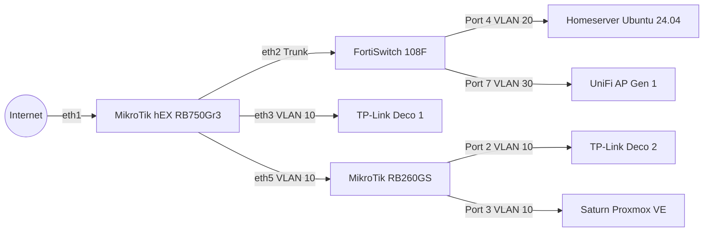
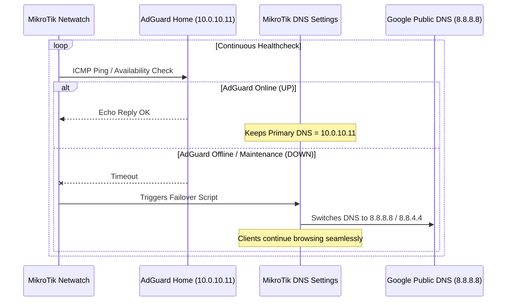

# Network Architecture, PKI & Security

> [!NOTE]
> All IP addresses and VLAN IDs in this document are **fictitious** (RFC 1918), while strictly reflecting the physical port wiring (Port Map), switching policies, and security flows of the production environment.

---

## 1. Physical L1/L2 Topology & Port Mapping (Port Map)

The **MikroTik hEX (RB750Gr3)** router acts as the central physical and logical distribution node. Rather than daisy-chaining the switches, both managed switches (**FortiSwitch 108F** and **MikroTik RB260GS**) connect directly to dedicated uplinks on the core router, reducing failure domains.

### Physical Wiring Diagram (Port-to-Port)

### Physical Port Mapping Tables

#### 1.1. Core Router — MikroTik hEX (`RB750Gr3`)

| Physical Port | Connected Device | Mode / VLAN | Operational Role |
| :---: | :--- | :--- | :--- |
| **ether1** | ISP Modem / ONT | WAN | Primary Internet uplink (DHCP/PPPoE Client + NAT Masquerade). |
| **ether2** | `FortiSwitch 108F` (Port 1) | Trunk (`802.1Q`) | Carries isolated VLAN tags (**VLAN 20 - Servers** and **VLAN 30 - Guests**). |
| **ether3** | `TP-Link Deco #1` | Access (`VLAN 10`) | Primary wireless access point for the trusted main network. |
| **ether4** | *Reserved / Local Management* | — | Spare port for physical Out-of-Band diagnostics. |
| **ether5** | `MikroTik RB260GS` (Port 1) | Access/Trunk (`VLAN 10`) | Uplink to the access switch serving `Saturn` (Proxmox) and the secondary Deco node. |

#### 1.2. Distribution Switch — Fortinet `FortiSwitch 108F`

| Physical Port | Connected Device | Mode / VLAN | Operational Role |
| :---: | :--- | :--- | :--- |
| **Port 1** | `MikroTik RB750Gr3` (ether2) | Trunk (`802.1Q`) | Primary trunk uplink receiving VLAN tags from the core router. |
| **Port 4** | `Homeserver` (`10.0.20.10`) | Access (`VLAN 20`) | Delivers the isolated servers VLAN untagged to the Docker/Storage host. |
| **Port 7** | `UniFi AP Gen 1` | Access (`VLAN 30`) | Delivers the isolated guest VLAN directly to the UniFi Access Point. |

#### 1.3. Access Switch — MikroTik `RB260GS` (SwOS)

| Physical Port | Connected Device | Mode / VLAN | Operational Role |
| :---: | :--- | :--- | :--- |
| **Port 1** | `MikroTik RB750Gr3` (ether5) | Uplink (`VLAN 10`) | Receives the primary infrastructure network segment. |
| **Port 2** | `TP-Link Deco #2` | Access (`VLAN 10`) | Secondary main Wi-Fi access point (wired Ethernet backhaul). |
| **Port 3** | `Saturn - Proxmox VE` | Access (`VLAN 10`) | Gigabit connectivity for the hypervisor and all hosted LXC containers / VMs. |

---

## 2. High-Availability DNS (Automated RouterOS Failover)

Network-wide ad and telemetry blocking is centralized on the **AdGuard Home** LXC container (`10.0.10.11`) hosted on Proxmox (`Saturn`).

Because the DNS server runs inside a container on the hypervisor, scheduled maintenance or a reboot of `Saturn` could cause a network-wide DNS outage. To eliminate this **Single Point of Failure (SPOF)**, the MikroTik `RB750Gr3` executes a native **DNS Failover** automation (via *Netwatch / RouterOS Scripting*):

- **Normal State (`UP`):** The MikroTik router forwards and distributes all DNS queries to `AdGuard Home` (`10.0.10.11`), ensuring ad filtering and telemetry collection.
- **Degraded State (`DOWN`):** If the AdGuard LXC stops responding, the MikroTik script automatically switches the resolver to Google Public DNS (`8.8.8.8`) and flushes the cache, restoring Internet resolution immediately. Once the container is back online, the `up-script` reverts DNS resolution back to AdGuard Home.

---

## 3. Internal PKI (`step-ca`) & Reverse Proxy (`Nginx Proxy Manager`)

### 3.1. Private Certificate Authority (`Smallstep step-ca`)
The environment operates an internal Public Key Infrastructure (PKI) inside a dedicated Debian LXC (`10.0.10.12`) running **Smallstep `step-ca`** under the internal domain `ga.lab.arpa`.
- **Objective:** Issue valid TLS certificates for internal services without relying on public ACME HTTP-01 validation (since `.arpa` is strictly local and ports 80/443 are never exposed to the WAN).
- **Applied Security:** Crucial for modern self-hosted applications that enforce HTTPS contexts (such as **Vaultwarden**, whose web vault and browser extensions require HTTPS to unlock the browser *WebCrypto API*).

### 3.2. Nginx Proxy Manager Architecture
The **Nginx Proxy Manager** container on `Homeserver` (`10.0.20.10`) centralizes HTTP/HTTPS access and TLS termination for three main web services:
1. **Jellyfin (`10.0.20.10:8097`):** Local upstream traffic within the Docker host (VLAN 20).
2. **Homarr v2 (`10.0.20.10:7576`):** Central infrastructure dashboard on the Docker host (VLAN 20).
3. **Vaultwarden (`10.0.10.15:8080`):** *Cross-VLAN* traffic. Nginx in VLAN 20 proxies HTTPS requests to the Vaultwarden LXC in VLAN 10 via an explicit MikroTik firewall pinhole allowing traffic strictly from `10.0.20.10` to `10.0.10.15:8080`.

---

## 4. Identity (IAM) & Zero-Trust Remote Access

### 4.1. Zero-Trust Remote Access (Tailscale)
No administrative ports (SSH, Proxmox WebUI, RDP, Gitea) are port-forwarded on the MikroTik WAN interface (`ether1`).
- Remote access is provided via a **Tailscale** overlay mesh VPN installed on two key nodes:
  - **RDP Workstation (`10.0.10.14` in VLAN 10):** Jump host for managing the primary infrastructure network, Proxmox WebUI, MikroTik WinBox/WebFig, and switches.
  - **Homeserver (`10.0.20.10` in VLAN 20):** Direct remote access to browser IDEs (`code-server`), Git repositories (`Gitea`), and Docker administration.

### 4.2. Identity Roadmap — Authentik (SSO)
The **Authentik** LXC container (`10.0.10.16`) is deployed in VLAN 10 to serve as a centralized *Identity Provider (IdP)* (OAuth2 / OIDC / Forward Auth) for upcoming self-hosted applications on the roadmap, including **Paperless-ngx** (document management system).
