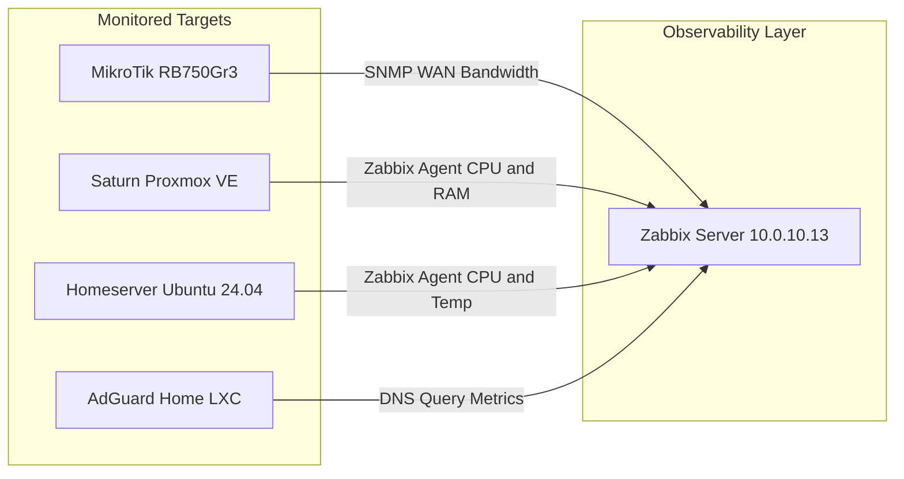

# Observability & Monitoring (Zabbix)

The observability layer of the homelab is centralized on **Zabbix Server** (`10.0.10.13`), hosted in a dedicated Debian LXC container on Proxmox (`Saturn`) provisioned with **2 vCPUs, 8 GB RAM, and 6 GB Swap** to support historical metric retention and trigger evaluation.

---

## 1. Telemetry Collection Architecture

Metric collection follows a hybrid approach combining **SNMP** for network hardware and **Zabbix Agent** for Linux servers:

### Target Monitoring Matrix

| Target | Zone | Protocol / Method | Key Metrics Collected |
| :--- | :---: | :--- | :--- |
| **MikroTik `RB750Gr3`** | Core / Edge | **SNMP** | WAN link throughput (`ether1`), per-interface traffic (`ether2`, `ether3`, `ether5`), and RouterOS CPU/memory utilization. |
| **Hypervisor `Saturn`** | VLAN 10 | **Zabbix Agent** | CPU load (`i3-7100T`), RAM pressure (16 GB), Swap usage, disk I/O, and free space on the 256 GB SSD. |
| **`Homeserver`** | VLAN 20 | **Zabbix Agent** | CPU load (`i7-9700`), **hardware thermal sensors (CPU/chassis temperature)**, RAM consumption, and storage capacity across the 250 GB SSD + 4 TB HDD. |
| **AdGuard Home** | VLAN 10 | **Agent / Integr.** | DNS query volume, block percentage, and service availability (complementing the MikroTik failover automation). |

---

## 2. Operational Dashboard (Main Dashboard)

The primary daily monitoring dashboard focuses on **4 critical infrastructure health indicators**:

1. **WAN Link & Interface Throughput (via SNMP on MikroTik):**
   - Real-time visibility into upload/download bandwidth on `ether1` (ISP link) and immediate identification of anomalous traffic or saturation caused by AI model pulls (`Ollama`), media streaming (`Jellyfin`), or inter-VLAN backup windows.
2. **CPU Utilization (`Saturn` vs. `Homeserver`):**
   - Side-by-side load comparison between the hypervisor (`i3-7100T`) and the container host (`i7-9700`), critical during local LLM inference in **Ollama** or photo indexing/ML tasks in **Immich**.
3. **Thermal Telemetry on `Homeserver`:**
   - Continuous physical temperature monitoring of the 8-core `Intel Core i7-9700` processor under heavy container workloads and sustained 4 TB HDD I/O, preventing *thermal throttling*.
4. **DNS Service Health & Usage (`AdGuard Home`):**
   - Tracking primary DNS resolver activity and correlating downtime events with automated failover triggers to Google DNS on the MikroTik router.

---

## 3. Observability Roadmap (Alerting)

- [ ] **Automated Discord Webhook Alerting:** Configuring a native Zabbix *Media Type* webhook pointing to a private Discord channel to deliver proactive notifications for:
  - High CPU temperature thresholds on `Homeserver` (`i7-9700`).
  - Primary DNS (`AdGuard Home`) outage and MikroTik failover activation.
  - Storage saturation (>85%) on the `Saturn` 256 GB SSD or `Homeserver` 4 TB HDD.
  - Host unavailability (ICMP/Agent unreachable).
