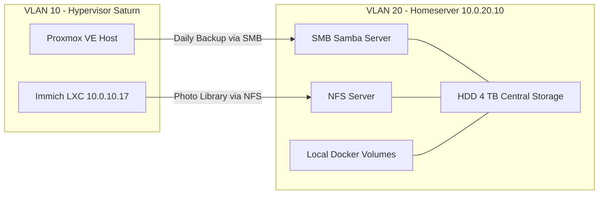

# Operational Runbooks & Storage Architecture (SOPs)

This document compiles the **Standard Operating Procedures (SOPs / Runbooks)** for managing distributed cross-VLAN storage, executing/restoring backups, and performing infrastructure maintenance.

---

## 1. Hybrid Cross-VLAN Storage Architecture

`Homeserver` (`10.0.20.10`, in VLAN 20) acts not only as a Docker application host, but also as a **Storage Server (NAS)** for the `Saturn` hypervisor (`10.0.10.x`, in VLAN 10), exporting volumes from its **4 TB HDD** over two distinct network filesystem protocols tailored to each workload:

### Network Share Breakdown

| Source (Client) | Destination (Server) | Protocol | Purpose | Protocol Selection Rationale |
| :--- | :--- | :---: | :--- | :--- |
| **Immich LXC (`10.0.10.17`)** | `Homeserver` (`10.0.20.10`) | **NFS** | Storage for raw photo and video uploads from mobile/web clients. | Lower overhead for Linux-to-Linux mounts and superior I/O performance when handling thousands of small thumbnail files. |
| **Proxmox VE (`Saturn`)** | `Homeserver` (`10.0.20.10`) | **SMB/CIFS** | Remote repository for nightly `vzdump` backup archives of all LXCs and VMs. | First-class integration with Proxmox VE Datacenter Storage using dedicated user authentication and automatic prune policies. |

---

## 2. Runbook 01 — Backup & Disaster Recovery (Proxmox `vzdump` via SMB)

### 2.1. Automated Backup Schedule
- **Schedule:** Executed automatically every night during early morning off-peak hours by the Proxmox VE scheduler (`Saturn`).
- **Target Storage:** SMB share mounted from the 4 TB HDD on `Homeserver` (`VLAN 20`).
- **Retention Policy (Prune):** Retains the **last 7 daily backups (1 full week)** for every LXC container and VM, automatically pruning older archives to conserve space on the 4 TB drive.

### 2.2. Emergency Restoration Procedure
If an LXC container or VM becomes corrupted after an update or configuration failure:

1. **Verify SMB Storage Connectivity:**
   - In the Proxmox VE WebUI (`Datacenter -> Storage`), confirm that the SMB storage on `Homeserver` is active and reachable across VLAN 20.
2. **Select the Recovery Point (RPO):**
   - Navigate to the affected container/VM -> **Backup** tab -> select the snapshot from the morning prior to the incident.
3. **Execute Restore:**
   - Click **Restore**, select the local target storage (`local-lvm` on `Saturn`'s 256 GB SSD), and start the restoration task.
4. **Post-Restore Validation Checklist:**
   - Start the restored container/VM.
   - If the restored workload is **Immich (`10.0.10.17`)**, verify that the **NFS** mount (`/mnt/fotos`) from `Homeserver` is properly mounted (`df -h` / `mount -a`).
   - If the restored workload is **AdGuard Home (`10.0.10.11`)**, verify on the MikroTik `RB750Gr3` that the Netwatch failover script switched primary network DNS back to `10.0.10.11`.
   - Check the **Zabbix (`10.0.10.13`)** dashboard to confirm CPU and availability metrics have returned to normal.

---

## 3. Runbook 02 — Secure Onboarding of a New Internal Web Service

When deploying a new internal web application (e.g., upcoming **Paperless-ngx** deployment):

1. **Workload Provisioning:**
   - Deploy the service via Docker Compose on `Homeserver` (VLAN 20) or inside a Debian LXC on `Saturn` (VLAN 10).
2. **TLS Certificate Issuance (`step-ca`):**
   - On the Local CA LXC (`10.0.10.12`), issue a certificate signed under `*.ga.lab.arpa` (e.g., `paperless.ga.lab.arpa`) using `step-ca`.
3. **Reverse Proxy Configuration (`Nginx Proxy Manager`):**
   - Create the Proxy Host entry in Nginx Proxy Manager (`10.0.20.10`) pointing to the service upstream.
   - *Note:* If the backend service lives in **VLAN 10 (`Saturn`)**, like Vaultwarden (`10.0.10.15`), add a granular `ACCEPT` pinhole rule on the **MikroTik `RB750Gr3`** firewall permitting traffic strictly from `10.0.20.10` to `<NEW_LXC_IP>:<PORT>`.
4. **Authentication & SSO (`Authentik`):**
   - Configure the *Provider* and *Application* in **Authentik (`10.0.10.16`)** to enforce Single Sign-On before exposing the service.
5. **Observability Registration (`Zabbix`):**
   - Register the new host/service in Zabbix to track availability and resource usage.

---

## 4. Runbook 03 — Preventive Hypervisor Maintenance (`Saturn`)

Before rebooting or upgrading the Proxmox VE kernel on `Saturn`:

1. **Verify Automated DNS Failover:**
   - Stopping `Saturn` will take the `AdGuard Home` LXC offline. Confirm that the **MikroTik `RB750Gr3`** Netwatch script automatically flips DNS to Google (`8.8.8.8`) so devices on the main Wi-Fi (TP-Link Deco) experience zero Internet downtime.
2. **Respect the Backup Window:**
   - Never reboot `Saturn` or `Homeserver` during the early morning window while `vzdump` is actively transferring backup archives over SMB to the 4 TB HDD.
3. **Power-On Boot Order:**
   - After a full power outage, ensure the **MikroTik `RB750Gr3`**, managed switches (`FortiSwitch 108F` and `RB260GS`), and **`Homeserver` (`10.0.20.10`)** reach operational state prior to or simultaneously with `Saturn`, preventing mount timeouts for **NFS (Immich)** and **SMB (Proxmox Backups)**.
